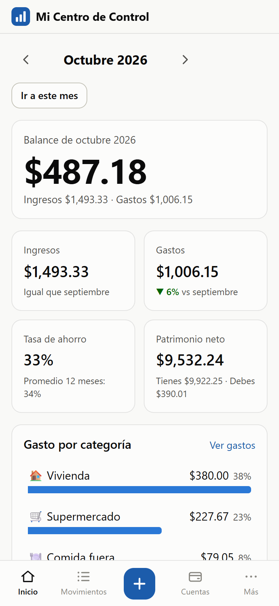
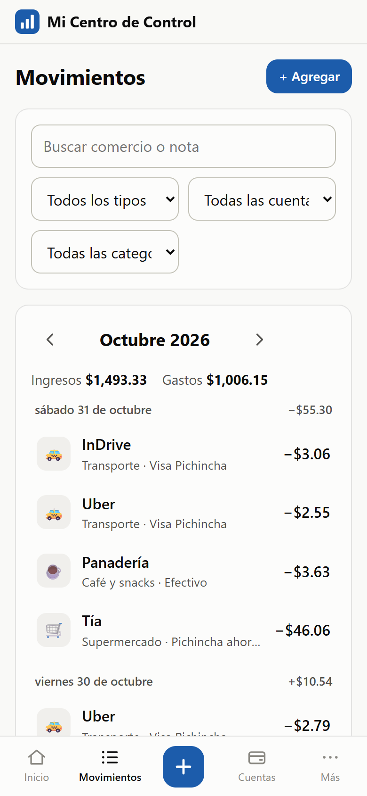
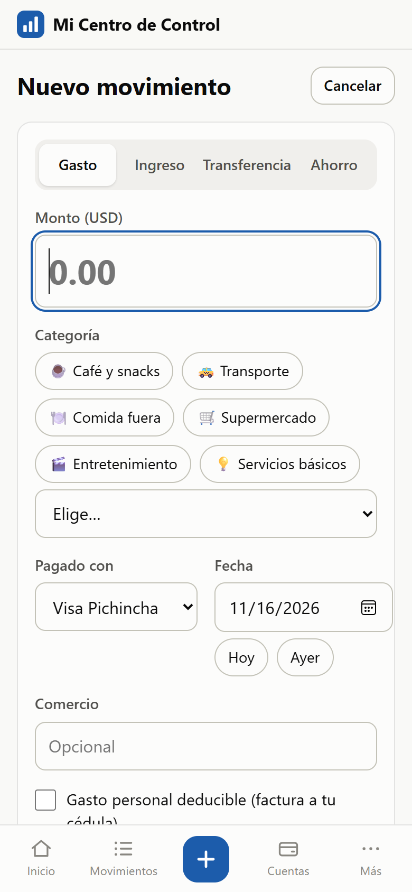
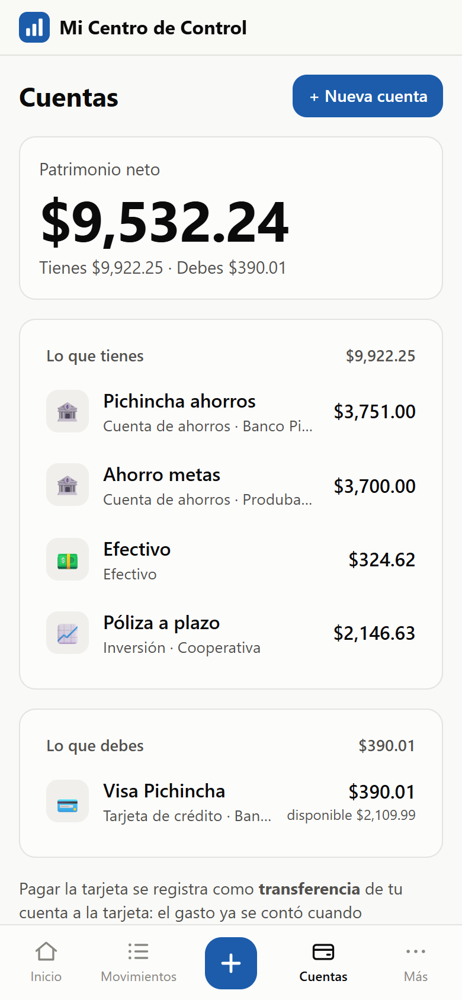
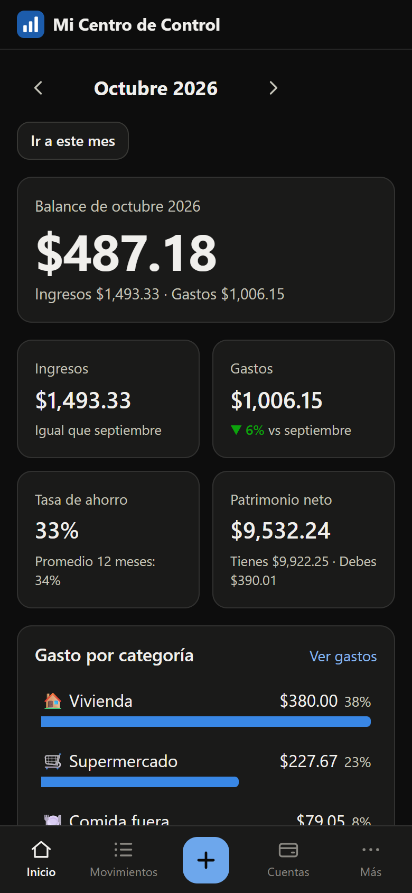

# Mi Centro de Control

**Personal finance & goals hub · Centro personal de finanzas y metas**

[English](#english) · [Español](#español) · [Build process / Proceso](docs/PROCESS.md)


| Mobile dashboard | Movements | New movement | Accounts | Dark mode |
|---|---|---|---|---|
|  |  |  |  |  |

*All screenshots use synthetic demo data generated by `app/demo.py`. No real financial data is published.*
*Todas las capturas usan datos de ejemplo generados por `app/demo.py`. No se publica ningún dato financiero real.*

---

## English

### What it is

A mobile-first web app I use to run my personal finances, built for daily life in Quito, Ecuador (USD,
America/Guayaquil time zone, Ecuador's SRI tax rules). It records income, expenses, transfers and savings, shows
where the money goes, and tracks net worth. Later phases add receipt scanning with AI, to-dos and goals, and a
data-driven financial advisor.

**Status:** Phase 1a is finished and deployed to production for personal use (Vercel + Neon PostgreSQL).
78 automated tests pass.

### Features (Phase 1a)

- **Sign-in:**
  - Argon2-hashed password plus a TOTP code (Google Authenticator), required in production.
  - Each code can be used only once.
  - Login lockout after repeated failures.
- **Accounts:** cash, savings, checking, credit cards (with credit limit, statement day and due day), investments
  and loans.
- **Movements:**
  - Expense, income, transfer and saving from a single form designed for the phone.
  - Your most-used categories appear as one-tap chips.
  - "Today" and "Yesterday" shortcuts for the date.
- **Ecuador tax helpers:**
  - Categories map to the SRI deductible personal-expense groups (housing, education, health, clothing, food,
    tourism).
  - Expenses can be flagged as deductible, with the invoice's RUC and 49-digit access key.
- **Dashboard:**
  - Monthly cash flow, savings rate and net worth (assets − debts).
  - Spending by category and 12-month trends, each chart with a data table.
  - Mid-month comparisons use the same day of the previous month, so a half month is not compared with a full one.
- **Backup:**
  - One-click ZIP with a full JSON plus one CSV per table, ready for Excel or Power BI.
  - Restore runs in a single transaction: if anything fails, nothing changes.
- **Installable on the phone** (web manifest), with light and dark mode.

### Tech stack

| Layer | Choice | Why |
|---|---|---|
| Backend | Python 3.13, FastAPI | Simple to maintain, typed, fast |
| UI | Server-rendered Jinja + HTMX + Chart.js | Almost no JavaScript; works well on phones |
| Data | SQLAlchemy 2.1 + Alembic; SQLite locally, PostgreSQL (Neon) in production | Real SQL and versioned migrations |
| Hosting | Vercel (Hobby, free) | HTTPS, runs migrations on every build |
| Security | Argon2, TOTP, signed cookies, CSRF tokens, strict CSP | A personal finance app must be private |
| Tests | pytest (78 tests) | Calculations, validation, auth, backup |

### Architecture

```
Phone / PC browser (installable web app)
   │ HTTPS · password + TOTP
   ▼
Vercel ─ FastAPI
   ├─ Jinja + HTMX pages, Chart.js charts
   └─ build step: alembic upgrade head
   ▼
Neon PostgreSQL (pooled connection for the app, direct connection for migrations)
```

### Design decisions

- **Pure calculation functions** (`app/finanzas/calculos.py`): balances, net worth, savings rate and trends take
  plain data and return numbers. They are tested without a database.
- **Money is exact:** `NUMERIC(12,2)` in the database and `Decimal` in Python, never `float`.
- **Accounting rules that avoid double counting:**
  - Paying a credit card is a *transfer*, not an expense; the expense was counted when you bought.
  - Saving is a transfer to a savings account.
  - Every account has a "book balance" (debts are negative), so net worth is a simple sum.
- **Opening balances:** each account starts from its balance at the beginning of a given day. Older history can be
  imported later without changing today's balance; earlier balances are computed backwards.
- **Amount parsing for local formats:** `1.234,56`, `1,234.56`, `$ 12`, and `0.005` treated as a decimal.
- **Database tables use Spanish names** so they can be queried directly from SQL or Power BI.

### How it was built

Full write-up with problems found and fixed: **[docs/PROCESS.md](docs/PROCESS.md)**.

1. **Requirements:** questions first, then a written plan covering architecture, data model, screens and phases,
   approved before any code ([docs/PLAN.md](docs/PLAN.md)).
2. **Phase 1a:** backend, pages and tests written together. Pure functions first, then routes, then templates.
3. **QA:**
   - Automated tests.
   - Manual checks in a phone-sized browser.
   - Screenshots generated with headless Edge over the DevTools protocol (`scripts/capturas.py`), which also
     caught two visual bugs.
4. **Deployment without Git installed:**
   - The code goes to GitHub with `dulwich`, a pure-Python Git library (`scripts/subir_github.py`). It scans for
     secrets before every commit.
   - Production is configured through the Vercel REST API from a small desktop window
     (`scripts/configurar_vercel.py`), so secrets never pass through the chat or the clipboard.

### Run locally

```powershell
python -m venv .venv
.\.venv\Scripts\python.exe -m pip install -r requirements-dev.txt
.\.venv\Scripts\python.exe scripts\crear_credenciales.py --demo   # local demo password: demo-centro-2026
.\.venv\Scripts\python.exe scripts\datos_demo.py                  # 12 months of synthetic data
.\.venv\Scripts\python.exe -m uvicorn app.main:app --reload       # http://localhost:8000
.\.venv\Scripts\python.exe -m pytest                              # 78 tests
```

### Deploy

1. Create a free Neon database.
2. Push the repository to GitHub.
3. Run `scripts\configurar_vercel.py`.

The window creates or reuses the Vercel project, stores six encrypted environment variables, deploys to
production and prints the URL. Every later push to `main` redeploys automatically. A manual alternative through
the Vercel dashboard is in [docs/GUIA.md](docs/GUIA.md).

### Roadmap

| Phase | Scope |
|---|---|
| 1b | Monthly budgets with alerts at 80% and 100%, savings goals, debts and subscriptions |
| 2 | Receipt photos read by Claude (vision), the official SRI e-invoice XML, CSV/Excel bank statement import |
| 3 | To-do board by area (work, gym, English, SQL, job applications, scholarships, goals) and a "Today" view |
| 4 | Weekly and monthly advisor based on computed facts, weekly review, reminders via Telegram |

---

## Español

### Qué es

Una app web pensada primero para el celular, que uso para llevar mis finanzas personales. Está hecha para la vida
diaria en Quito: USD, hora de Ecuador y reglas del SRI. Registra ingresos, gastos, transferencias y ahorros,
muestra en qué se va el dinero y sigue el patrimonio neto. Las próximas fases agregan lectura de recibos con IA,
pendientes y metas, y un asesor financiero basado en datos.

**Estado:** la Fase 1a está terminada y en producción para uso personal (Vercel + Neon PostgreSQL). Pasan 78
pruebas automáticas.

### Funciones (Fase 1a)

- **Acceso:**
  - Contraseña con hash Argon2 más código TOTP (Google Authenticator), obligatorio en producción.
  - Cada código sirve una sola vez.
  - Bloqueo temporal tras varios intentos fallidos.
- **Cuentas:** efectivo, ahorros, corriente, tarjetas (con cupo, día de corte y día de pago), inversiones y
  préstamos.
- **Movimientos:**
  - Gasto, ingreso, transferencia y ahorro desde un solo formulario pensado para el celular.
  - Las categorías que más usas aparecen como botones.
  - Atajos «Hoy» y «Ayer» para la fecha.
- **Ayudas tributarias (SRI):**
  - Las categorías se asocian a los rubros de gastos personales deducibles (vivienda, educación, salud,
    vestimenta, alimentación, turismo).
  - Los gastos se pueden marcar como deducibles, con el RUC y la clave de acceso de 49 dígitos de la factura.
- **Dashboard:**
  - Flujo del mes, tasa de ahorro y patrimonio neto (lo que tienes − lo que debes).
  - Gasto por categoría y tendencias de 12 meses, cada gráfico con su tabla.
  - A mitad de mes, la comparación es contra el mismo día del mes anterior, para no comparar medio mes con un mes
    completo.
- **Respaldo:**
  - ZIP con un clic: JSON completo más un CSV por tabla, listo para Excel o Power BI.
  - La restauración se hace en una sola transacción: si algo falla, no cambia nada.
- **Instalable en el celular** (manifiesto web), con modo claro y oscuro.

### Tecnologías

| Capa | Elección | Por qué |
|---|---|---|
| Backend | Python 3.13, FastAPI | Simple de mantener, tipado, rápido |
| Interfaz | Jinja en el servidor + HTMX + Chart.js | Casi sin JavaScript; funciona bien en el celular |
| Datos | SQLAlchemy 2.1 + Alembic; SQLite en local, PostgreSQL (Neon) en producción | SQL real y migraciones versionadas |
| Hosting | Vercel (Hobby, gratis) | HTTPS; ejecuta las migraciones en cada despliegue |
| Seguridad | Argon2, TOTP, cookies firmadas, tokens CSRF, CSP estricta | Una app de finanzas personales debe ser privada |
| Pruebas | pytest (78 pruebas) | Cálculos, validaciones, acceso y respaldo |

### Arquitectura

```
Navegador del celular / PC (app instalable)
   │ HTTPS · contraseña + TOTP
   ▼
Vercel ─ FastAPI
   ├─ páginas Jinja + HTMX, gráficos Chart.js
   └─ al desplegar: alembic upgrade head
   ▼
Neon PostgreSQL (conexión con pooler para la app, directa para las migraciones)
```

### Decisiones de diseño

- **Cálculos en funciones puras** (`app/finanzas/calculos.py`): saldos, patrimonio, tasa de ahorro y tendencias
  reciben datos y devuelven números. Se prueban sin base de datos.
- **Montos exactos:** `NUMERIC(12,2)` en la base y `Decimal` en Python, nunca `float`.
- **Reglas contables que evitan contar dos veces:**
  - Pagar la tarjeta es una *transferencia*, no un gasto; el gasto se contó al comprar.
  - Ahorrar es una transferencia a una cuenta de ahorros.
  - Cada cuenta tiene un «saldo contable» (las deudas son negativas), así el patrimonio es una simple suma.
- **Saldos iniciales:** cada cuenta parte de su saldo al inicio de un día. Se puede importar historia anterior sin
  cambiar el saldo de hoy; los saldos de antes se calculan hacia atrás.
- **Lectura de montos en formatos locales:** `1.234,56`, `1,234.56`, `$ 12`, y `0.005` como decimal.
- **Tablas con nombres en español** para consultarlas directo desde SQL o Power BI.

### Cómo se construyó

El relato completo, con los problemas encontrados y cómo se resolvieron, está en
**[docs/PROCESS.md](docs/PROCESS.md)**.

1. **Requisitos:** primero preguntas, luego un plan escrito con arquitectura, modelo de datos, pantallas y fases,
   aprobado antes de escribir código ([docs/PLAN.md](docs/PLAN.md)).
2. **Fase 1a:** backend, páginas y pruebas escritos juntos. Primero las funciones puras, luego las rutas y al
   final las plantillas.
3. **Control de calidad:**
   - Pruebas automáticas.
   - Revisiones en un navegador del tamaño de un celular.
   - Capturas generadas con Edge sin ventana mediante el protocolo DevTools (`scripts/capturas.py`), que además
     detectaron dos errores visuales.
4. **Despliegue sin Git instalado:**
   - El código se sube a GitHub con `dulwich`, una librería de Git en Python puro (`scripts/subir_github.py`).
     Antes de cada commit busca secretos.
   - Producción se configura por la API de Vercel desde una pequeña ventana (`scripts/configurar_vercel.py`), así
     los secretos nunca pasan por el chat ni por el portapapeles.

### Probar en tu PC

```powershell
python -m venv .venv
.\.venv\Scripts\python.exe -m pip install -r requirements-dev.txt
.\.venv\Scripts\python.exe scripts\crear_credenciales.py --demo   # contraseña de la demo local: demo-centro-2026
.\.venv\Scripts\python.exe scripts\datos_demo.py                  # 12 meses de datos de ejemplo
.\.venv\Scripts\python.exe -m uvicorn app.main:app --reload       # http://localhost:8000
.\.venv\Scripts\python.exe -m pytest                              # 78 pruebas
```

### Publicar

1. Crea una base gratuita en Neon.
2. Sube el repositorio a GitHub.
3. Ejecuta `scripts\configurar_vercel.py`.

La ventana crea o reutiliza el proyecto en Vercel, guarda seis variables de entorno cifradas, despliega a
producción y muestra la dirección. Cada push posterior a `main` vuelve a desplegar solo. La alternativa manual
desde el panel de Vercel está en [docs/GUIA.md](docs/GUIA.md).

### Próximas fases

| Fase | Contenido |
|---|---|
| 1b | Presupuestos mensuales con alertas al 80 % y al 100 %, metas de ahorro, deudas y suscripciones |
| 2 | Fotos de recibos leídas por Claude (visión), XML oficial de la factura electrónica del SRI, importación de estados de cuenta CSV/Excel |
| 3 | Tablero de pendientes por área (trabajo, gimnasio, inglés, SQL, postulaciones, becas, metas) y vista «Hoy» |
| 4 | Asesor semanal y mensual basado en hechos calculados, revisión semanal y recordatorios por Telegram |

---

**Author / Autor:** Bryan Andrés Romo Arias · [GitHub](https://github.com/BryanAndresR23) ·
[LinkedIn](https://www.linkedin.com/in/bryanromo)
