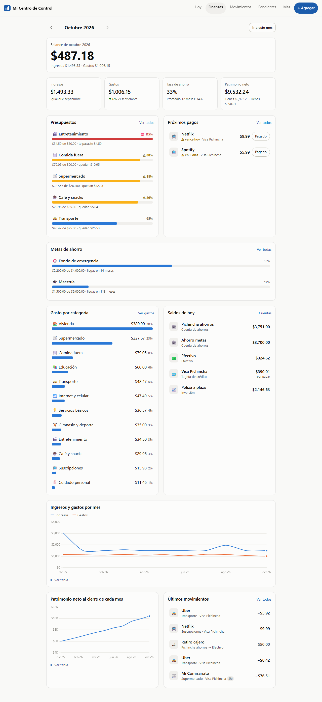
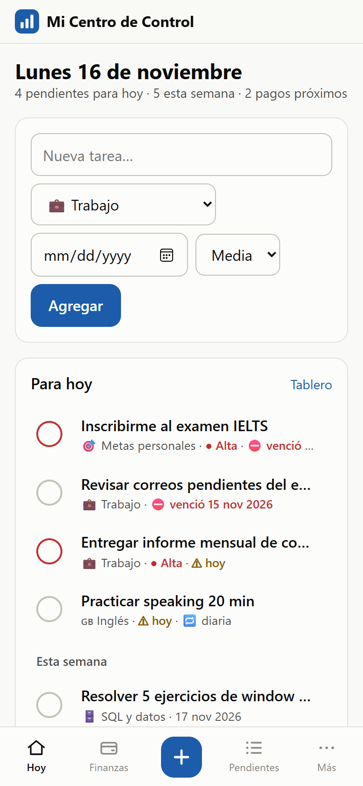
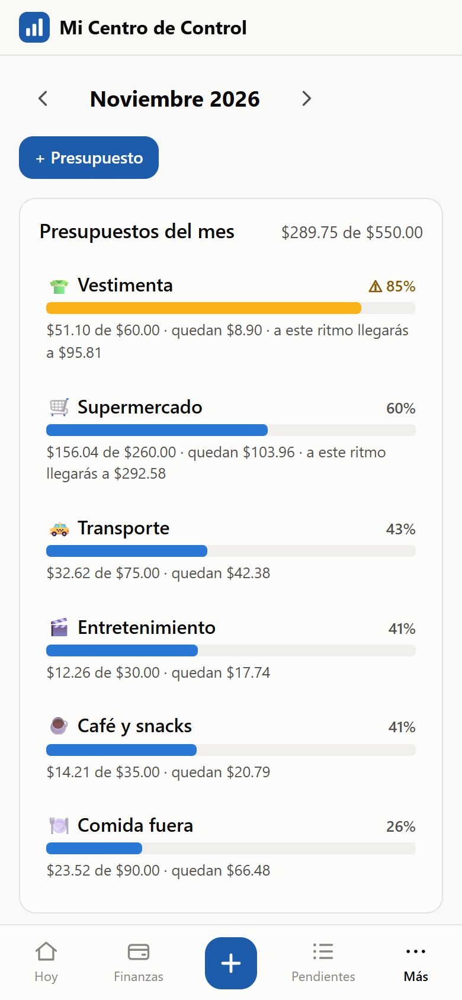
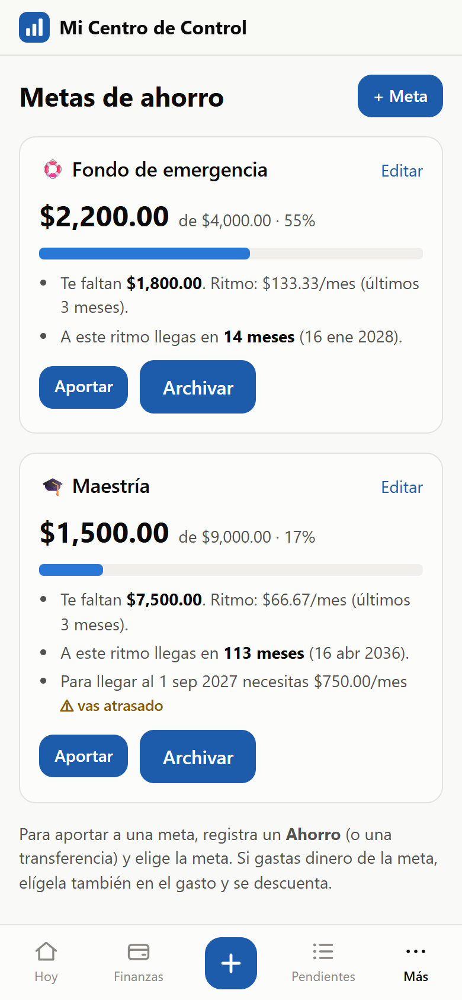
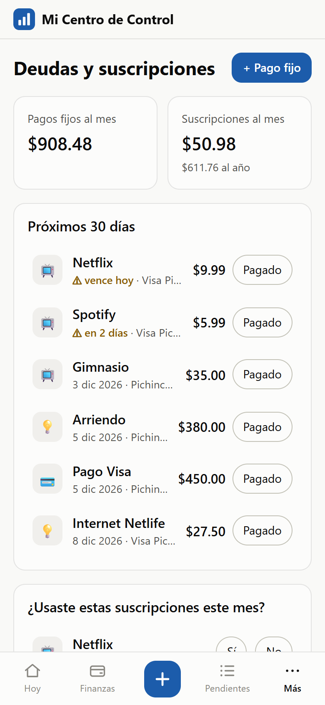
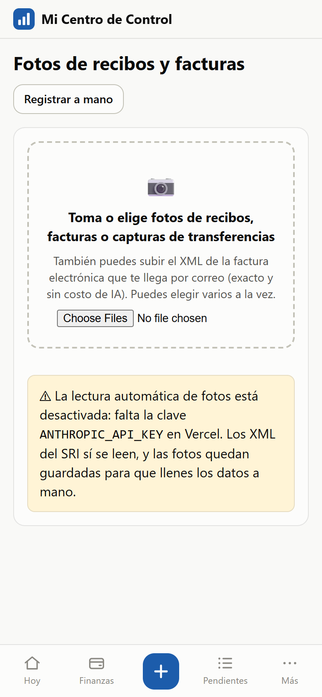
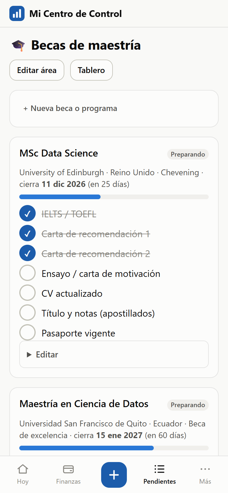

# Mi Centro de Control

**Personal finance, to-dos & goals hub · Centro personal de finanzas, pendientes y metas**

[English](#english) · [Español](#español) · [Build process / Proceso](docs/PROCESS.md) · [Guía de uso](docs/GUIA.md)



| Today | Budgets | Savings goals | Bills & subscriptions | Receipts | Scholarships | Dark mode |
|---|---|---|---|---|---|---|
|  |  |  |  |  |  |  |

*All screenshots use synthetic demo data generated by `app/demo.py`. No real financial data is published.*
*Todas las capturas usan datos de ejemplo generados por `app/demo.py`. No se publica ningún dato financiero real.*

---

## English

### What it is

A mobile-first web app I use every day. It is built for life in Quito, Ecuador: USD, the
America/Guayaquil time zone and Ecuador's SRI tax rules. It brings together:
- **Personal finances:** accounts, budgets, savings goals, bills, receipt scanning and an advisor.
- **To-dos and goals:** work, gym, English, SQL, job applications and scholarships.

When I open the app, the **Today** view shows what I have to do and pay today and this week.

**Status:** all four phases are built and deployed for personal use on Vercel + Neon PostgreSQL. There are 116
automated tests.

### Features

**Finances**
- **Accounts and movements:**
  - Cash, banks, credit cards, investments and loans.
  - Expenses, income, transfers and savings from one phone-friendly form.
  - Accounting that never counts anything twice: a card payment is a transfer, not an expense.
- **Budgets:**
  - A monthly limit per category, with an in-app alert when you cross 80 % and 100 %.
  - A projection of where you'll end the month at the current pace.
  - When a limit changes, past months keep their old budget.
- **Savings goals:** progress, monthly pace, estimated date and the monthly amount needed to reach a target date.
- **Bills and subscriptions:**
  - Due dates, with a one-tap "Paid" button that records the movement and moves the date forward.
  - Monthly and annual cost of your subscriptions.
  - A monthly "did you use it?" check to catch unused subscriptions.
- **Receipt photos:**
  - Photos are resized on the phone and read by Claude (vision, structured JSON output).
  - Shows merchant, RUC, date, subtotal, VAT, total and a suggested category, all editable before saving; batch
    upload works too.
- **SRI e-invoices:**
  - Upload the XML you get by email, or let the app fetch the authorized XML using the 49-digit access key,
    validated with its check digit.
  - Flags invoices issued to "consumidor final", which are not deductible.
- **Bank statement import:** CSV/XLSX with column detection, debit/credit or signed amounts, duplicate detection
  and automatic categories that learn from your corrections.
- **Dashboard:** cash flow, savings rate, net worth, spending by category, 12-month trends, budgets, goals and
  upcoming bills.

**To-dos and goals**
- **Areas, each with its own template:**
  - *Work* (deliverables).
  - *Fitness* (weekly routine, sets and weight, estimated 1RM).
  - *English* and *SQL* (hours per week vs. goal, daily streak, level).
  - *Job applications* (pipeline with status history).
  - *Scholarships* (deadlines and a document checklist).
  - *Personal goals* (quarterly or yearly, broken into milestones).
- **New areas** take two clicks.
- **Tasks:** due dates, priority, recurring tasks (daily, weekly, monthly) and milestones.
- **Today view:** overdue tasks and today's tasks first, sorted by urgency and then priority. It also shows this
  week's tasks, bills, budget alerts, today's workout, study streaks and job and scholarship deadlines.

**Advisor and reminders**
- **Weekly and monthly advisor:**
  - The code computes the facts: spending vs. your average, small "ant" expenses, unused subscriptions, savings
    rate, and "cut X and you reach your goal N months sooner".
  - Claude writes 2–4 concrete tips, each citing the facts it is based on. Tips with invalid citations are
    discarded.
  - Without an API key, you still get the facts and rule-based tips.
- **Weekly review:** what you finished, what is overdue, study and workout progress, and the top 3 priorities.
- **Telegram reminders:** a daily digest at 07:00 (Quito) through a Vercel Cron Job, covering tasks, bills by
  their notice days, budget alerts (one per threshold), scholarship deadlines and next steps in job applications.

### Tech stack

| Layer | Choice |
|---|---|
| Backend | Python 3.13, FastAPI |
| UI | Server-rendered Jinja + HTMX + Chart.js (installable web app, light and dark mode) |
| Data | SQLAlchemy 2.1 + Alembic · SQLite locally, PostgreSQL on Neon in production |
| AI | Claude API (`claude-opus-5-5` by default, configurable): vision + structured outputs, server-side refusal fallback |
| Hosting | Vercel Hobby (free) + Vercel Cron |
| Security | Argon2, TOTP 2FA, signed cookies, CSRF, strict CSP, login lockout |
| Tests | pytest, 116 tests |

### Architecture

```
Phone / PC (installable web app)
   │ HTTPS · password + TOTP
   ▼
Vercel ─ FastAPI ── Jinja + HTMX pages
   ├─ receipts ───────► Claude (vision) · SRI web service (authorized XML)
   ├─ advisor ────────► facts computed in Python → Claude writes the tips
   ├─ /cron/diario ───► Telegram (daily 07:00 Quito)
   └─ build: alembic upgrade head
   ▼
Neon PostgreSQL
```

### Design decisions

- **Pure functions for every calculation:** finances, budgets, goals, recurring payments, the Today ordering,
  streaks and advisor facts are all tested without a database.
- **Exact money:** `NUMERIC(12,2)` in the database and `Decimal` in Python, never `float`.
- **The AI never computes numbers.** It only phrases facts the code has already calculated, and every tip must
  cite them.
- **Features degrade gracefully:**
  - Without an AI key, XML invoices and imports still work, and photos are stored for manual entry.
  - Without Telegram, everything else works.
- **Database tables use Spanish names** so they can be queried from SQL or Power BI.

### Run locally

```powershell
python -m venv .venv
.\.venv\Scripts\python.exe -m pip install -r requirements-dev.txt
.\.venv\Scripts\python.exe scripts\crear_credenciales.py --demo   # local demo password: demo-centro-2026
.\.venv\Scripts\python.exe scripts\datos_demo.py                  # 12 months of synthetic data + to-dos
.\.venv\Scripts\python.exe -m uvicorn app.main:app --reload       # http://localhost:8000
.\.venv\Scripts\python.exe -m pytest                              # 116 tests
```

### Deploy

1. Create a free Neon database.
2. Push the code to GitHub (`scripts\subir_github.py`).
3. Run `scripts\configurar_vercel.py`. Its window:
   - creates or reuses the Vercel project;
   - stores the encrypted environment variables (including the optional Anthropic key and Telegram bot);
   - generates `CRON_SECRET` and deploys.

`vercel.json` schedules the daily cron job.

| Variable | Required | Purpose |
|---|---|---|
| `ENTORNO`, `DATABASE_URL`, `DATABASE_URL_MIGRACIONES`, `SECRET_KEY`, `APP_PASSWORD_HASH`, `TOTP_SECRET` | Yes | App, database and login |
| `ANTHROPIC_API_KEY`, `MODELO_IA` | Optional | Receipt reading and advisor wording |
| `TELEGRAM_BOT_TOKEN`, `TELEGRAM_CHAT_ID`, `CRON_SECRET` | Optional | Daily reminders |

---

## Español

### Qué es

Una app web pensada primero para el celular, que uso a diario. Está hecha para la vida en Quito: USD, hora de
Ecuador y reglas del SRI. Junta dos cosas:
- **Finanzas personales:** cuentas, presupuestos, metas de ahorro, pagos fijos, lectura de recibos y asesor.
- **Pendientes y metas:** trabajo, gimnasio, inglés, SQL, postulaciones y becas.

Al abrirla, la vista **Hoy** muestra lo que toca hacer y pagar hoy y esta semana.

**Estado:** las cuatro fases están construidas y en producción para uso personal (Vercel + Neon PostgreSQL), con
116 pruebas automáticas.

### Funciones

**Finanzas**
- **Cuentas y movimientos:**
  - Efectivo, bancos, tarjetas, inversiones y préstamos.
  - Gastos, ingresos, transferencias y ahorros desde un solo formulario pensado para el celular.
  - Contabilidad que no cuenta nada dos veces: pagar la tarjeta es una transferencia, no un gasto.
- **Presupuestos:**
  - Tope mensual por categoría, con aviso en pantalla al pasar el 80 % y el 100 %.
  - Proyección de cuánto gastarás a fin de mes al ritmo actual.
  - Si cambias el monto, los meses pasados conservan su presupuesto.
- **Metas de ahorro:** progreso, ritmo mensual, fecha estimada y cuánto ahorrar por mes para llegar a una fecha
  objetivo.
- **Deudas y suscripciones:**
  - Vencimientos con botón «Pagado», que registra el movimiento y avanza la fecha.
  - Costo mensual y anual de tus suscripciones.
  - Una pregunta mensual («¿la usaste?») para detectar las que no usas.
- **Fotos de recibos:**
  - Las fotos se reducen en el celular y las lee Claude (visión con salida JSON estructurada).
  - Muestra comercio, RUC, fecha, subtotal, IVA, total y una categoría sugerida, todo editable antes de guardar;
    también puedes subir varias a la vez.
- **Facturas electrónicas del SRI:**
  - Subes el XML que te llega al correo, o la app trae el XML autorizado con la clave de acceso de 49 dígitos,
    validada con su dígito verificador.
  - Avisa si la factura salió a «consumidor final», que no es deducible.
- **Importación de estados de cuenta:** CSV/XLSX con detección de columnas, débito/crédito o monto con signo,
  sin duplicados y con categorías que aprenden de tus correcciones.
- **Dashboard:** flujo del mes, tasa de ahorro, patrimonio, gasto por categoría, tendencias de 12 meses,
  presupuestos, metas y próximos pagos.

**Pendientes y metas**
- **Áreas, cada una con su plantilla:**
  - *Trabajo* (entregables).
  - *Fitness* (rutina semanal, series y peso, 1RM estimado).
  - *Inglés* y *SQL* (horas por semana frente al objetivo, racha diaria, nivel).
  - *Postulaciones* (embudo con historial de estados).
  - *Becas* (fechas límite y checklist de documentos).
  - *Metas personales* (trimestrales o anuales, divididas en hitos).
- **Áreas nuevas** en dos clics.
- **Tareas:** fecha límite, prioridad, repetición diaria, semanal o mensual, e hitos.
- **Vista Hoy:** primero lo vencido y lo de hoy, ordenado por urgencia y luego por prioridad. También muestra lo de
  la semana, los pagos, las alertas de presupuesto, el entrenamiento del día, las rachas de estudio y las fechas
  de postulaciones y becas.

**Asesor y recordatorios**
- **Asesor semanal y mensual:**
  - El código calcula los hechos: gasto frente a tu promedio, gastos hormiga, suscripciones sin uso, tasa de
    ahorro, y «si recortas X llegas N meses antes».
  - Claude redacta de 2 a 4 consejos concretos, y cada uno cita los hechos en que se basa. Los consejos con
    citas inválidas se descartan.
  - Sin clave de API, igual ves los hechos y consejos basados en reglas.
- **Revisión semanal:** lo que completaste, lo vencido, el avance de estudio y entrenamiento, y las 3 prioridades.
- **Recordatorios por Telegram:** resumen diario a las 07:00 (Quito) con un Cron Job de Vercel. Incluye tareas,
  pagos según sus días de aviso, alertas de presupuesto (una por umbral), fechas límite de becas y próximos pasos
  de postulaciones.

### Tecnologías

| Capa | Elección |
|---|---|
| Backend | Python 3.13, FastAPI |
| Interfaz | Jinja en el servidor + HTMX + Chart.js (app instalable, modo claro y oscuro) |
| Datos | SQLAlchemy 2.1 + Alembic · SQLite en local, PostgreSQL en Neon en producción |
| IA | API de Claude (`claude-opus-5-5` por defecto, configurable): visión + salida estructurada, con respaldo automático si el modelo rechaza una solicitud |
| Hosting | Vercel Hobby (gratis) + Vercel Cron |
| Seguridad | Argon2, 2FA TOTP, cookies firmadas, CSRF, CSP estricta, bloqueo de intentos |
| Pruebas | pytest, 116 pruebas |

### Decisiones de diseño

- **Funciones puras para todos los cálculos:** finanzas, presupuestos, metas, recurrentes, el orden de la vista Hoy,
  las rachas y los hechos del asesor se prueban sin base de datos.
- **Montos exactos:** `NUMERIC(12,2)` en la base y `Decimal` en Python, nunca `float`.
- **La IA no calcula cifras.** Solo redacta hechos que el código ya calculó, y cada consejo debe citarlos.
- **Las funciones se degradan con elegancia:**
  - Sin clave de IA, igual funcionan los XML y la importación, y las fotos se guardan para llenar a mano.
  - Sin Telegram, funciona todo lo demás.
- **Tablas con nombres en español** para consultarlas desde SQL o Power BI.

### Probar en tu PC

```powershell
python -m venv .venv
.\.venv\Scripts\python.exe -m pip install -r requirements-dev.txt
.\.venv\Scripts\python.exe scripts\crear_credenciales.py --demo   # contraseña de la demo local: demo-centro-2026
.\.venv\Scripts\python.exe scripts\datos_demo.py                  # 12 meses de datos de ejemplo + pendientes
.\.venv\Scripts\python.exe -m uvicorn app.main:app --reload       # http://localhost:8000
.\.venv\Scripts\python.exe -m pytest                              # 116 pruebas
```

### Publicar

1. Crea una base gratuita en Neon.
2. Sube el código a GitHub (`scripts\subir_github.py`).
3. Ejecuta `scripts\configurar_vercel.py`. Su ventana:
   - crea o reutiliza el proyecto en Vercel;
   - guarda las variables cifradas (incluidas la clave opcional de Anthropic y el bot de Telegram);
   - genera `CRON_SECRET` y despliega.

`vercel.json` programa el recordatorio diario. Los pasos detallados están en la [guía](docs/GUIA.md).

---

**Author / Autor:** Bryan Andrés Romo Arias · [GitHub](https://github.com/BryanAndresR23) ·
[LinkedIn](https://www.linkedin.com/in/bryanromo)
